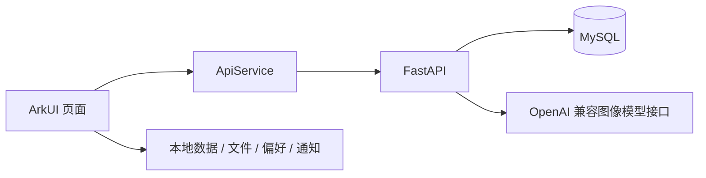

# 系统架构

## 模块职责

- `mobile/entry/src/main/ets/pages/`：应用页面与交互。
- `mobile/entry/src/main/ets/service/`：网络访问、本地持久化、文件与提醒。
- `backend/main.py`：当前集中定义 FastAPI 路由、Pydantic 模型、SQLAlchemy 模型与 AI 调用；尚未进一步拆分业务层。
- `database/`：建库脚本与历史 SQL 说明，当前表结构以 ORM 为准。

## 数据与实现边界

后端包含用户、植物、成长记录、提醒、百科和收藏模型。图片通过 Base64 存储与传输，尚未实现独立对象存储。移动端同时保留本地数据库服务，不能将它描述成已实现通用的离线同步协议。

登录成功会签发 JWT，但业务路由尚未通过统一鉴权依赖验证令牌或资源归属。`get_today_reminders` 当前筛选用户的全部未完成提醒，并未按当天时间范围过滤。百科表在新环境为空，需要维护内容。

这些是现有实现的边界，目录整理不会自动补齐。历史论文和汇报用于追溯设计背景，不能替代当前代码行为。
